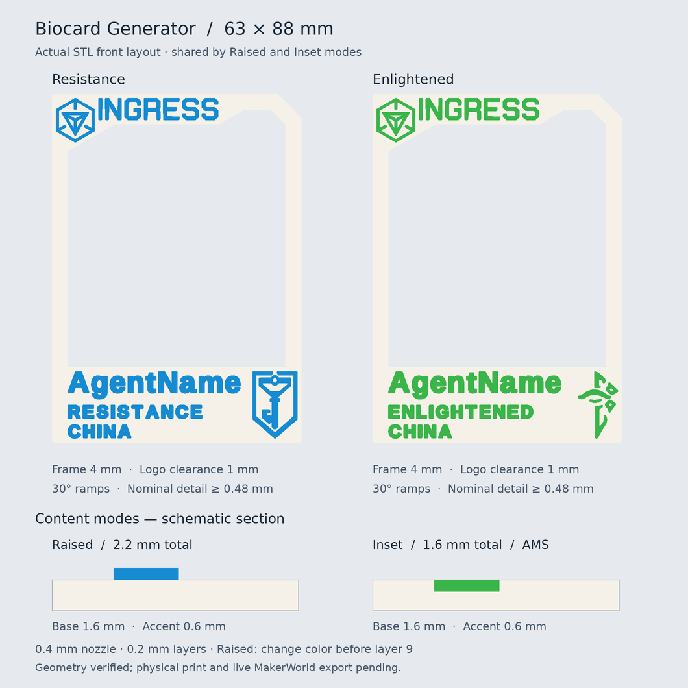

# Ingress Biocard 3D

生成可定制姓名、地点和阵营的双色 Ingress 镂空卡片，适用于 MakerWorld Parametric Model Maker 和 OpenSCAD。

卡片尺寸固定为 **63 × 88 mm**，最窄边框固定为 **4 mm**。左上 Ingress Logo 与字标固定，右下 Logo 随 Resistance／Enlightened 阵营切换。图案已内嵌，无需另行上传 SVG。

## 使用

1. 下载 `ingress_biocard.scad`，在 MakerWorld Parametric Model Maker 中打开，或用支持 `textmetrics()` 的 OpenSCAD 开发版打开。OpenSCAD 2021.01 不支持此模型所需的文字测量功能；较旧开发版可能需要在 Preferences → Features 中启用 textmetrics。
2. 设置姓名、地点、阵营、字体和颜色，选择凸起或嵌入模式。
3. 生成模型，优先下载彩色 3MF。导入切片器后，核对两零件的共同位置、底面 Z=0 和实际耗材分配。

字体必须包含所用字符。内容过长会报错，请缩短文字或减小字间距。上线前请在 MakerWorld 编辑器确认所选字体及模型能够正常生成。

## 参数

| 参数 | 默认值／用途 |
|---|---|
| `codename` | `AgentName`，姓名 |
| `location` | `CHINA`，地点 |
| `faction` | `Resistance`；可切换为 `Enlightened` |
| `font_name` | `Liberation Sans:style=Bold`，个人信息字体 |
| `agentname_spacing` | 姓名可见字间距，默认 0.5 mm，可调 0.4–2 mm |
| `detail_spacing` | 阵营和地点可见字间距，默认 0.5 mm，可调 0.4–2 mm |
| `bottom_band` | 身份信息栏高度，默认 19 mm，可调 18–24 mm |
| `base_thickness` | 底框厚度，默认 1.6 mm |
| `corner_chamfer` | 平面小倒角，默认 0.4 mm |
| `top_right_cut` | 右上剪角，默认 6 mm |
| `content_mode` | `Raised`（凸起）或 `Inset`（嵌入） |
| `accent_height` | 凸起高度或嵌入深度，默认 0.6 mm |
| `layer_height` | 层高校验值，默认 0.2 mm；不会修改切片器设置 |
| `body_color` | 底框颜色 |
| `use_faction_color` | 默认启用阵营蓝／绿色；关闭后使用 `accent_color` |
| `resistance_color` / `enlightened_color` / `accent_color` | 强调色 |
| `export_part` | `Assembly`（整体）、`Base`（底框）或 `Accent`（文字和图案） |

左下文字左边距为 **4 mm**，两处行间空隙相等，完整三行文字组上下各留 **1 mm**。文字过宽时自动等比缩小，窄字母保留字体原生比例。右下 Logo 与信息栏上、下、右边各留 1 mm。

## 双色打印

推荐从 **0.4 mm 喷嘴、PLA、0.2 mm 固定层高**开始，卡片背面贴床，文字朝上。

### Raised：凸起

默认总厚度 **2.2 mm**：底框 1.6 mm，文字和图案凸起 0.6 mm。可用 AMS，也可按高度换色；首层及后续层均为 0.2 mm 时，**第 9 层开始前换色**。使用不同首层或可变层高时，以切片器实际路径为准。

### Inset：嵌入

默认总厚度 **1.6 mm**，正面平整，内容填入底框上方 0.6 mm 深的区域。需要 **AMS 或等效多材料系统**，不能靠一次按高度换色完成。背面实心层不得薄于 0.8 mm。

### 文件导入与检查

- 彩色 3MF 导入后，手动核对 `Base`／`Accent` 的耗材分配；显示颜色不保证对应正确耗材槽。
- 使用 STL 时，同时导入 `Base` 和 `Accent`，作为一个对象的多个零件，保持共同坐标。不要单独落床或排列字母。
- `Assembly` STL 不保存颜色；嵌入模式请使用多零件 3MF 或 Base／Accent 配对 STL。
- 通用 3MF 不包含已经切片的 Bambu 打印配置。某些导入器会改变整体高度位置，请检查底面 Z=0，并保持零件间的相对位置。
- 图案和文字按名义 **0.48 mm** 最小细节适配，细尖角会圆化，微小孔洞可能闭合。打印前检查每层字母、Logo 和孔洞的实际挤出路径，再用自己的机器与耗材试印。

## 素材说明

Ingress Logo、字标及阵营图案使用提供的 SVG，并为打印调整细节。阵营 SVG 原作者标注为 **Cory Hughart**。

本项目为非官方粉丝作品，与 Ingress、Niantic、Bambu Lab 或 MakerWorld 无官方关联。第三方图案的使用与分发应遵守原素材授权。
